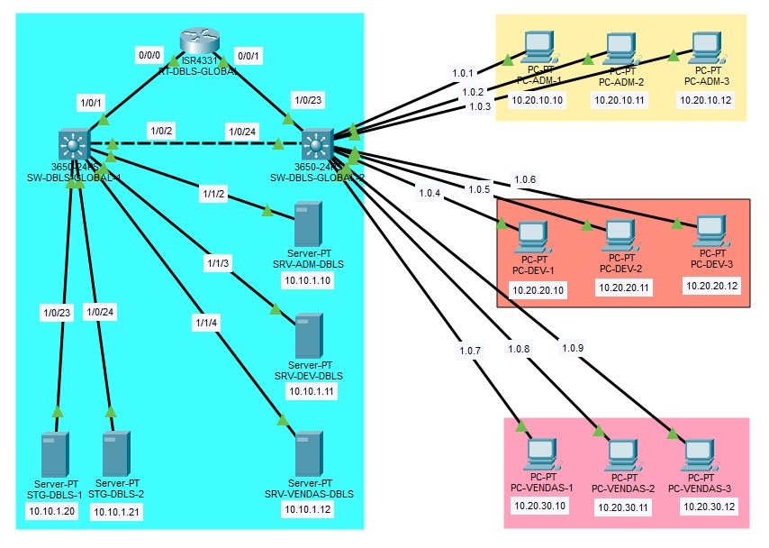

# 🏢 DBLS Global — Arquitetura de Rede Corporativa Resiliente e Segmentada (básico)

Projeto de infraestrutura de redes corporativas desenvolvido no **Cisco Packet Tracer**, simulando um ambiente empresarial completo com núcleo redundante em Camada 3, segmentação estrita por VLANs e ACLs, serviços dedicados por departamento, autenticação AAA/RADIUS, camada de armazenamento espelhada e rotina de backup de ativos de rede via TFTP.



---

## 🎯 Objetivos do Projeto

* **Alta Disponibilidade (HA):** Eliminar pontos únicos de falha no gateway e no roteamento de núcleo com **HSRP** e **OSPF**.
* **Segurança e Isolamento Lateral (Zero Trust Interno):** Impedir comunicação lateral entre setores (ADM, DEV e VENDAS) e bloquear o acesso direto das estações de trabalho ao plano de gerenciamento dos switches de núcleo via **Extended ACLs**.
* **Autonomia de Serviços:** Entregar DNS, portais HTTP customizados, e-mail interno e FTP com controle granular de privilégios por departamento.
* **Operação de NOC:** Implementar armazenamento redundante (`STG-DBLS-1` e `STG-DBLS-2`), servidor **AAA (RADIUS)** e backup centralizado de `running-config` via **TFTP**.

---

## 🏗️ Arquitetura e Plano de Endereçamento

### 1. Ativos de Núcleo e Roteamento
| Equipamento | Modelo | Função Principal | Router-ID (OSPF) | Links de Uplink |
| :--- | :--- | :--- | :---: | :--- |
| **RT-DBLS-GLOBAL** | Cisco ISR 4331 | Roteador Central / Borda | `3.3.3.3` | `Gi0/0/0` (`172.16.1.1/30`) • `Gi0/0/1` (`172.16.2.1/30`) |
| **SW-DBLS-GLOBAL-1** | Catalyst 3650-24PS | Core L3 (HSRP Active / STP Root / DHCP) | `1.1.1.1` | `Gi1/0/1` (`172.16.1.2/30`) |
| **SW-DBLS-GLOBAL-2** | Catalyst 3650-24PS | Core L3 (HSRP Standby / Acesso) | `2.2.2.2` | `Gi1/0/23` (`172.16.2.2/30`) |

### 2. Segmentação por VLANs e HSRP
| VLAN | Setor | Sub-rede | Gateway Virtual (HSRP) | SW1 (Active - Pri 110) | SW2 (Standby - Pri 100) |
| :---: | :--- | :--- | :---: | :---: | :---: |
| **10** | ADM | `10.20.10.0/24` | `10.20.10.1` | `10.20.10.2` | `10.20.10.3` |
| **20** | DEV | `10.20.20.0/24` | `10.20.20.1` | `10.20.20.2` | `10.20.20.3` |
| **30** | VENDAS | `10.20.30.0/24` | `10.20.30.1` | `10.20.30.2` | `10.20.30.3` |
| **100** | Datacenter | `10.10.1.0/24` | `10.10.1.1` | `10.10.1.2` | `10.10.1.3` |

* **Spanning Tree (PVST):** `SW-DBLS-GLOBAL-1` configurado como *Root Bridge* (`priority 24576`) para as VLANs `10, 20, 30, 100`.
* **DHCP:** Pools `POOL-ADM`, `POOL-DEV` e `POOL-VENDAS` centralizados no `SW-DBLS-GLOBAL-1`, distribuindo IP, gateway HSRP e DNS dedicado de cada setor.

---

## 🖥️ Servidores, Storages e Serviços

### Servidores Departamentais (VLAN 100)
| Servidor | IP | Serviços Ativos | Registros DNS (A Records) | Detalhes dos Serviços |
| :--- | :---: | :--- | :--- | :--- |
| **SRV-ADM-DBLS** | `10.10.1.10` | HTTP, DNS, E-mail | `portal.adm.dbls.local`<br>`mail.dbls.local`<br>`stg1.dbls.local`<br>`stg2.dbls.local` | **HTTP:** Intranet ADM (Portal Administrativo)<br>**E-mail (`dbls.com`):** `diretoria`, `financeiro`, `rh` |
| **SRV-DEV-DBLS** | `10.10.1.11` | HTTP, DNS, FTP | `homolog.dev.dbls.local`<br>`deploy.dev.dbls.local`<br>`stg1.dbls.local`<br>`stg2.dbls.local` | **HTTP:** DBLS DevOps (Ambiente de Homologação)<br>**FTP:** `dev_lead` (RWDNL), `dev_jr` (WL), `dev_estagio` (W) |
| **SRV-VENDAS-DBLS** | `10.10.1.12` | HTTP, DNS, E-mail, AAA | `crm.vendas.dbls.local`<br>`mail.vendas.dbls.local`<br>`stg1.dbls.local`<br>`stg2.dbls.local` | **HTTP:** DBLS CRM (Portal Comercial)<br>**E-mail (`dbls.com`):** `gerente`, `executivo1`, `executivo2`<br>**AAA (RADIUS):** Porta `1645` para cliente `SW-DBLS-GLOBAL` (`10.10.1.2`) |

### Camada de Storage e Backup (VLAN 100)
| Storage | IP | Serviços Ativos | Contas FTP e Permissões |
| :--- | :---: | :--- | :--- |
| **STG-DBLS-1** | `10.10.1.20` | FTP | `noc_admin` (RWDNL) • `dev_bkp` (RWNL) • `adm_bkp` (RWL) • `vendas_bkp` (RWL) |
| **STG-DBLS-2** | `10.10.1.21` | FTP, TFTP | `noc_admin` (RWDNL) • `dev_bkp` (RWDL) • `adm_bkp` (RWL) • `vendas_bkp` (RWL)<br>**TFTP:** Repositório oficial de backup `.cfg` (`running-config`) dos switches e roteador |

---

## 🛡️ Políticas de Segurança (Extended ACLs)

As ACLs estendidas foram aplicadas na entrada (`in`) das SVIs das VLANs `10`, `20` e `30` em ambos os switches de núcleo (`SW-DBLS-GLOBAL-1` e `SW-DBLS-GLOBAL-2`), garantindo consistência mesmo em caso de failover do HSRP.

### Matriz de Acesso Validada
| Origem | Servidor Próprio | Servidores de Outros Setores | PCs de Outros Setores | Switches (`SW1` / `SW2`) | Storages (`STG-1` / `STG-2`) | Roteador (`RT-DBLS-GLOBAL`) |
| :--- | :---: | :---: | :---: | :---: | :---: | :---: |
| **VLAN 10 (ADM)** | ✅ Permitido | ❌ Bloqueado | ❌ Bloqueado | ❌ Bloqueado | ✅ Permitido | ✅ Permitido |
| **VLAN 20 (DEV)** | ✅ Permitido | ❌ Bloqueado | ❌ Bloqueado | ❌ Bloqueado | ✅ Permitido | ✅ Permitido |
| **VLAN 30 (VENDAS)** | ✅ Permitido | ❌ Bloqueado | ❌ Bloqueado | ❌ Bloqueado | ✅ Permitido | ✅ Permitido |

* **Isolamento de E-mail:** O envio e recebimento de mensagens via SMTP/POP3 ocorre exclusivamente entre estações do mesmo departamento (sem comunicação cruzada entre salas).

### Exemplo de Implementação (`ACL-VLAN10-ADM`)
```cisco
ip access-list extended ACL-VLAN10-ADM
 permit ip 10.20.10.0 0.0.0.255 host 10.10.1.10
 permit ip 10.20.10.0 0.0.0.255 host 10.10.1.20
 permit ip 10.20.10.0 0.0.0.255 host 10.10.1.21
 deny   ip 10.20.10.0 0.0.0.255 10.10.1.0 0.0.0.255
 deny   ip 10.20.10.0 0.0.0.255 10.20.0.0 0.0.255.255
 permit ip any any
```

---

## ✅ Validações e Testes Realizados

* **Convergência OSPF & HSRP:** Verificação de adjacências `FULL` com o roteador central e failover automático de tráfego via `RT-DBLS-GLOBAL` em caso de queda do link entre switches.
* **Isolamento por ACL:** Testes de ICMP confirmando bloqueio entre VLANs e para os IPs de gerenciamento dos switches, com liberação exclusiva para o servidor do setor, storages e roteador central.
* **Serviços de Aplicação:** Resolução DNS (`nslookup`), acesso aos 3 portais HTTP customizados, troca de e-mails internos por setor e autenticação FTP com restrição de escrita/exclusão por perfil.
* **Backup e Recuperação de Desastres:** Exportação e validação de leitura da `running-config` dos switches para o `STG-DBLS-2` via TFTP (`copy running-config tftp:`).

---

## 🛠️ Tecnologias e Protocolos Utilizados

`Cisco Packet Tracer` • `VLANs (802.1Q)` • `PVST+` • `HSRP` • `OSPF (Area 0)` • `Extended ACLs` • `DHCP` • `DNS` • `HTTP` • `SMTP/POP3` • `FTP` • `TFTP` • `AAA (RADIUS)`

---

## 📁 Como Executar o Projeto

1. Instale o **Cisco Packet Tracer** (versão 8.2 ou superior).
2. Faça o download do arquivo `.pkt` disponível neste repositório.
3. Abra o projeto, aguarde a convergência do STP/OSPF (ou clique em *Fast Forward Time*) e teste os acessos via navegador, cliente de e-mail e CLI nos PCs de cada setor.